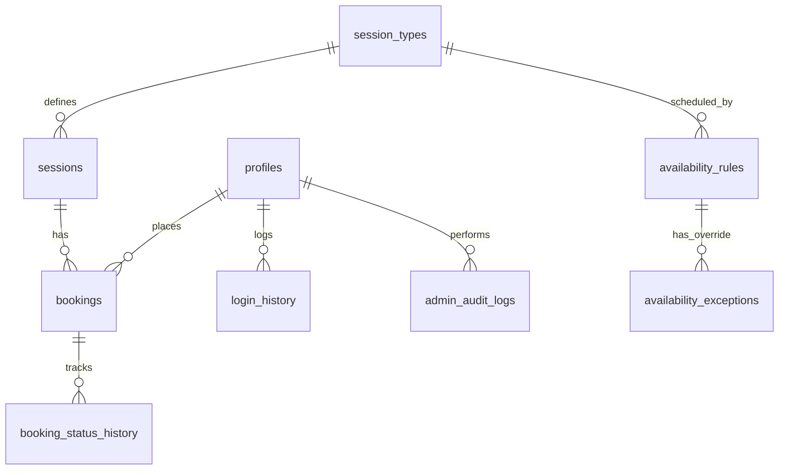

# ZenCare Chiropractic - Backend & Dashboard Implementation Plan

This document outlines the detailed, step-by-step implementation plan for integrating a Supabase backend and building client & admin dashboards for the ZenCare Chiropractic web application.

---

## 🎨 Branding & UI/UX Guide

To maintain visual cohesion with the existing marketing landing page, all dashboard elements and pages will strictly adhere to the following design system.

### 1. Typography & Foundations
- **Primary Font**: `Inter` (sans-serif)
- **Scale**: Heavy emphasis on clean visual hierarchy with subtle margins, spacious letter-spacing for headings, and high-readability body copy.

### 2. Color Palette (HSL variables from `index.css`)
- **Background**: Soft Sage / Light Grayish Green `hsl(140, 25%, 98%)` (Dark mode: `hsl(200, 20%, 8%)`)
- **Foreground (Text)**: Deep Charcoal / Slate `hsl(200, 20%, 15%)` (Dark mode: `hsl(140, 15%, 95%)`)
- **Primary (Buttons, Highlights)**: Pine Green / Muted Teal `hsl(152, 45%, 42%)` (Dark mode: `hsl(152, 45%, 50%)`)
- **Accent (CTAs, Gold Highlights)**: Ochre / Gold `hsl(42, 65%, 55%)` (Dark mode: `hsl(42, 60%, 50%)`)
- **Card Background**: Clean pure white/mint-tinted card `hsl(140, 20%, 99%)` (Dark mode: `hsl(200, 20%, 10%)`)
- **Gradients & Glows**: Use the signature Aurora Glow (`--aurora-violet` and `--aurora-green`) to give dashboard card headers and hero panels a high-end, premium feel.

### 3. UI Elements (Shadcn Reference)
We will use custom elements patterned after **Shadcn UI** styles:
- **Buttons**: Rounded-lg shapes with smooth transitions, subtle hover scales, and clean text.
- **Calendar**: Customized Radix-based date pickers showing slot availabilities.
- **Toasts**: Micro-animated screen toasts showing exclusively in the **top-left corner**.
- **Page Rules**: Unique slugs rather than nested modal pages (e.g. `/admin/clients/[id]` or `/client/bookings/[id]`). Use modals **only** for quick confirmations (e.g., cancelling a booking, banning a user) and quick inline field edits.

---

## 📂 Navigation & Page Routes

We will implement a clean route architecture using `react-router-dom`:

### 1. General / Public / Auth Pages
- `/login` - Simple auth screen using Supabase Auth UI or customized inputs.
- `/signup` - User sign-up (default role: `user`).
- `/profile` - User settings, updating name, contact info, and security. Modals used for specific sub-actions.

### 2. Client Pages (Route Group: `/client/*`)
- `/client/dashboard` - Quick access to next appointment, list of active bookings, and quick booking CTA.
- `/client/bookings` - Tabular booking history and scheduling flow for new appointments.

### 3. Admin Pages (Route Group: `/admin/*`)
- `/admin/dashboard` - Clinic statistics (occupancy, bookings rate, top session types, user growth charts).
- `/admin/sessions` - CRUD panel for listing, creating, and modifying session instances and session types.
- `/admin/booking` - Master calendar showing all clinic slot distributions, quick manual check-in, and cancellations.
- `/admin/reporting` - Reports on booking history, logins, session metrics, and export functions.
- `/admin/clients` - List of users, client upgrade tracking, and ban/reject action overrides.
- `/admin/settings` - Manage availability rules, clinic settings, and exception overrides.

---

## 🗄️ Database Schema & Architecture (Supabase)

Below is the proposed relational schema designed for PostgreSQL in Supabase.



### Tables

#### 1. `profiles`
Stores user profile information, role state, and approval status.
```sql
CREATE TYPE user_role AS ENUM ('user', 'client', 'admin');
CREATE TYPE user_status AS ENUM ('active', 'rejected', 'banned');

CREATE TABLE profiles (
  id UUID REFERENCES auth.users ON DELETE CASCADE PRIMARY KEY,
  email TEXT UNIQUE NOT NULL,
  full_name TEXT NOT NULL,
  phone TEXT,
  role user_role DEFAULT 'user'::user_role NOT NULL,
  status user_status DEFAULT 'active'::user_status NOT NULL,
  created_at TIMESTAMP WITH TIME ZONE DEFAULT timezone('utc'::text, now()) NOT NULL,
  updated_at TIMESTAMP WITH TIME ZONE DEFAULT timezone('utc'::text, now()) NOT NULL
);
```

#### 2. `session_types`
Defines template parameters for clinic operations.
```sql
CREATE TABLE session_types (
  id UUID DEFAULT gen_random_uuid() PRIMARY KEY,
  title TEXT NOT NULL,
  description TEXT,
  duration_minutes INTEGER NOT NULL DEFAULT 30,
  default_price NUMERIC(10, 2) NOT NULL DEFAULT 0.00,
  max_slots INTEGER NOT NULL DEFAULT 1,
  created_at TIMESTAMP WITH TIME ZONE DEFAULT timezone('utc'::text, now()) NOT NULL,
  updated_at TIMESTAMP WITH TIME ZONE DEFAULT timezone('utc'::text, now()) NOT NULL
);
```

#### 3. `sessions`
Specific instances of a session on the calendar.
```sql
CREATE TYPE session_status AS ENUM ('active', 'cancelled', 'completed');

CREATE TABLE sessions (
  id UUID DEFAULT gen_random_uuid() PRIMARY KEY,
  session_type_id UUID REFERENCES session_types(id) ON DELETE RESTRICT NOT NULL,
  title TEXT NOT NULL,
  location TEXT,
  description TEXT,
  max_slots INTEGER NOT NULL,
  pricing NUMERIC(10, 2) NOT NULL,
  start_time TIMESTAMP WITH TIME ZONE NOT NULL,
  end_time TIMESTAMP WITH TIME ZONE NOT NULL,
  status session_status DEFAULT 'active'::session_status NOT NULL,
  cancel_reason TEXT,
  cancelled_at TIMESTAMP WITH TIME ZONE,
  created_at TIMESTAMP WITH TIME ZONE DEFAULT timezone('utc'::text, now()) NOT NULL,
  updated_at TIMESTAMP WITH TIME ZONE DEFAULT timezone('utc'::text, now()) NOT NULL
);
```

#### 4. `bookings`
Links clients to scheduled session slots.
```sql
CREATE TYPE booking_status AS ENUM ('pending', 'confirmed', 'cancelled', 'completed');

CREATE TABLE bookings (
  id UUID DEFAULT gen_random_uuid() PRIMARY KEY,
  user_id UUID REFERENCES profiles(id) ON DELETE CASCADE NOT NULL,
  session_id UUID REFERENCES sessions(id) ON DELETE CASCADE NOT NULL,
  status booking_status DEFAULT 'pending'::booking_status NOT NULL,
  notes TEXT,
  cancel_reason TEXT,
  created_at TIMESTAMP WITH TIME ZONE DEFAULT timezone('utc'::text, now()) NOT NULL,
  updated_at TIMESTAMP WITH TIME ZONE DEFAULT timezone('utc'::text, now()) NOT NULL,
  UNIQUE(user_id, session_id) -- Avoids duplicate bookings for same session
);
```

#### 5. `availability_rules`
Defines base availability patterns for scheduling sessions automatically or validating booking hours.
```sql
CREATE TABLE availability_rules (
  id UUID DEFAULT gen_random_uuid() PRIMARY KEY,
  session_type_id UUID REFERENCES session_types(id) ON DELETE CASCADE,
  day_of_week INTEGER NOT NULL CHECK (day_of_week BETWEEN 0 AND 6), -- 0 = Sunday
  start_time TIME NOT NULL,
  end_time TIME NOT NULL,
  is_active BOOLEAN DEFAULT TRUE NOT NULL,
  created_at TIMESTAMP WITH TIME ZONE DEFAULT timezone('utc'::text, now()) NOT NULL
);
```

#### 6. `availability_exceptions`
Advanced exception scheduling (block out holiday dates, adjust specific time bounds).
```sql
CREATE TABLE availability_exceptions (
  id UUID DEFAULT gen_random_uuid() PRIMARY KEY,
  rule_id UUID REFERENCES availability_rules(id) ON DELETE CASCADE,
  exception_date DATE NOT NULL,
  start_time TIME,
  end_time TIME,
  is_blocked BOOLEAN DEFAULT TRUE NOT NULL, -- True means fully closed on this date
  reason TEXT,
  created_at TIMESTAMP WITH TIME ZONE DEFAULT timezone('utc'::text, now()) NOT NULL
);
```

#### 7. `login_history`
Tracks user login instances for security audit.
```sql
CREATE TABLE login_history (
  id UUID DEFAULT gen_random_uuid() PRIMARY KEY,
  user_id UUID REFERENCES profiles(id) ON DELETE CASCADE NOT NULL,
  ip_address TEXT,
  user_agent TEXT,
  logged_in_at TIMESTAMP WITH TIME ZONE DEFAULT timezone('utc'::text, now()) NOT NULL
);
```

#### 8. `booking_status_history`
Tracks changes in bookings (e.g. from pending -> confirmed -> cancelled).
```sql
CREATE TABLE booking_status_history (
  id UUID DEFAULT gen_random_uuid() PRIMARY KEY,
  booking_id UUID REFERENCES bookings(id) ON DELETE CASCADE NOT NULL,
  previous_status booking_status,
  new_status booking_status NOT NULL,
  changed_by UUID REFERENCES profiles(id) ON DELETE SET NULL,
  change_reason TEXT,
  created_at TIMESTAMP WITH TIME ZONE DEFAULT timezone('utc'::text, now()) NOT NULL
);
```

#### 9. `admin_audit_logs`
Tracks admin management acts (banning users, editing global rules, deleting metadata).
```sql
CREATE TABLE admin_audit_logs (
  id UUID DEFAULT gen_random_uuid() PRIMARY KEY,
  admin_id UUID REFERENCES profiles(id) ON DELETE SET NULL,
  action TEXT NOT NULL,
  target_table TEXT NOT NULL,
  target_id UUID,
  description TEXT,
  created_at TIMESTAMP WITH TIME ZONE DEFAULT timezone('utc'::text, now()) NOT NULL
);
```

---

## ⚡ Business Logic & Backend Automations

### 1. User-to-Client Upgrades
We will run a PostgreSQL Trigger on the `bookings` table:
* When a booking's status changes to `'confirmed'` (meaning their first session booking is approved), the trigger automatically updates their profile role from `'user'` to `'client'`.

### 2. Client Suspension & Rejection
* Profile status is set to `'banned'` or `'rejected'` by admins.
* Row Level Security (RLS) policies on `bookings` and `sessions` tables will block queries and insertions for any profile marked with `banned` or `rejected` status.

### 3. Logins auditing
* Handled via a Supabase Edge Function triggered by auth log events to write record instances to `login_history`.

---

## 🚀 Implementation Roadmap (Phase by Phase)

### Phase 1: Database Setup
1. Apply SQL migrations for roles, enums, tables, foreign keys, and indexes.
2. Enable Row Level Security (RLS) on all tables.
3. Add automatic triggers for updating `updated_at` timestamps.
4. Implement the trigger for upgrading user role to `'client'` upon their first confirmed booking.

### Phase 2: Supabase Authentication
1. Implement the signup and login pages (`/signup` and `/login`) with Supabase client-side integrations.
2. Hook up authentication state to client context providers.
3. Configure redirect rules based on user role (`admin` -> `/admin/dashboard`, `client`/`user` -> `/client/dashboard`).

### Phase 3: Toast Notification Component
1. Configure a top-left toast container using standard micro-animations.
2. Hook notification triggers into auth changes, booking status updates, and admin action outcomes.

### Phase 4: Client Booking & Dashboard Flow
1. Build `/client/dashboard` interface.
2. Implement date-selection calendar validating availability rules and exceptions.
3. Allow clients to request a booking, triggering status updates and real-time confirmations.

### Phase 5: Admin Panel & CRUD Controllers
1. Create `/admin/dashboard` showing analytical charts.
2. Set up CRUD screens for session templates (`session_types`) and active instances (`sessions`).
3. Set up the clients' review panel (`/admin/clients`) with actions to ban or reject users.

### Phase 6: Exception Scheduling Panel
1. Build interface under `/admin/settings` allowing admins to set general calendar schedules, and input holiday exceptions or therapist unavailability blocks.
2. Integrate availability checkers into client booking calendar flow.
